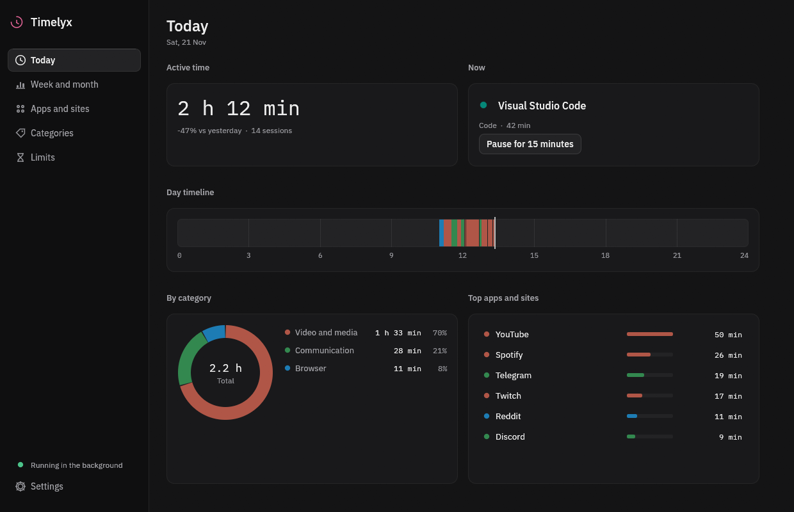
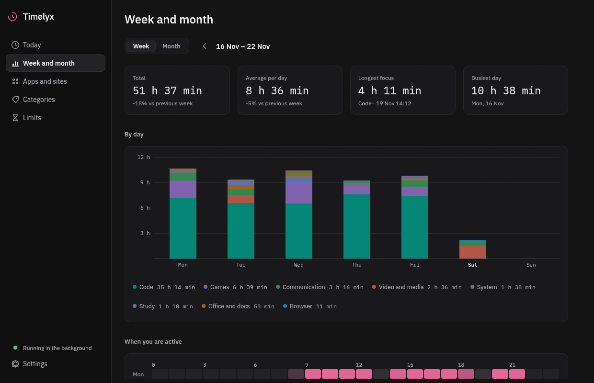
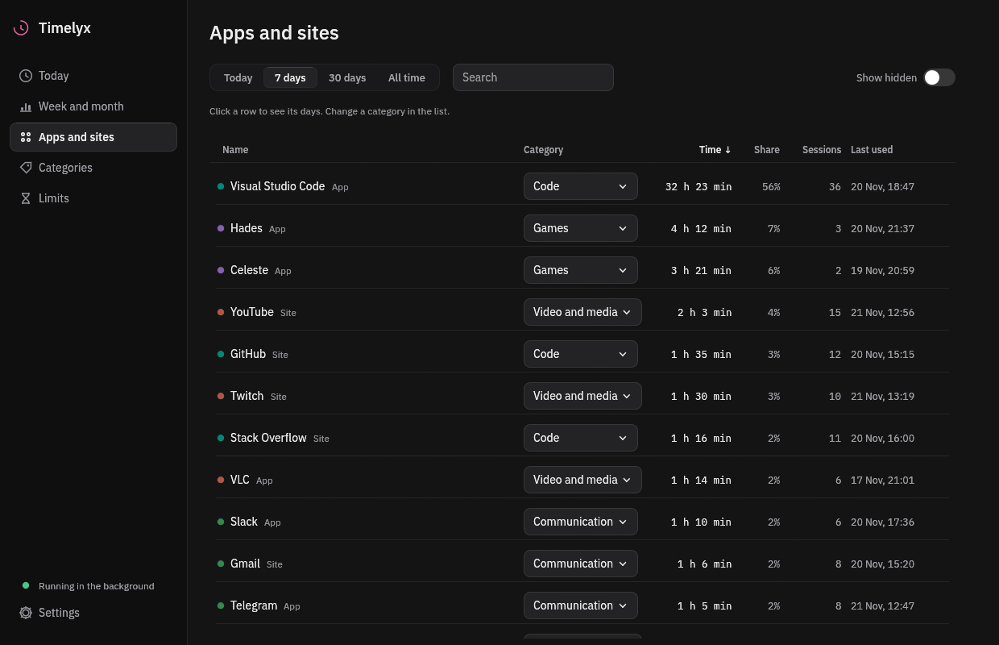
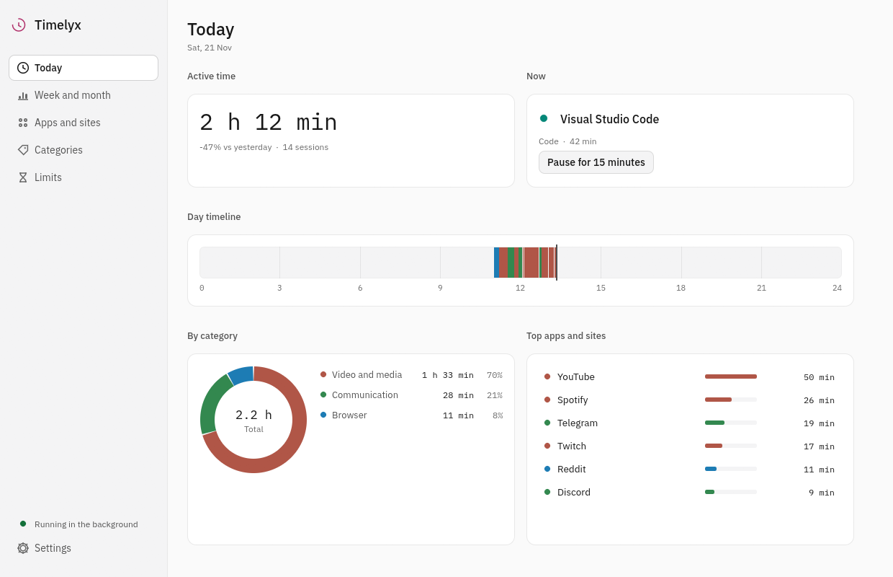
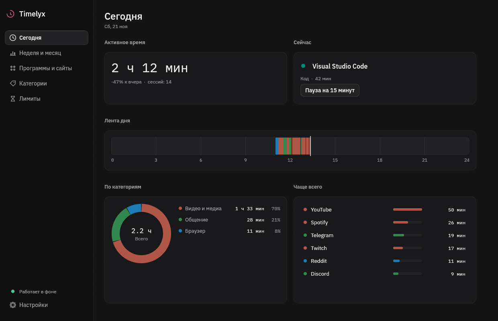

# Timelyx

An automatic, local activity tracker for Windows and Linux. It records which program (and, in browsers, which site) you are using and for how long, and shows where the day went: a 24 hour timeline, categories, week and month charts and a weekday-by-hour heatmap. No timers to start, no account, no cloud. Part of the [NIMVORO](https://github.com/GrigoryyKach/nimvoro) suite.



## Features

- **Fully automatic.** Timelyx starts with the computer and follows the window in front. Time stops counting when you stop touching the keyboard and mouse (5 minutes by default), when the screen is locked, and while the computer sleeps. The idle minutes are never counted: the session is closed back-dated to your last input. A full screen window (a game, a film) and the Video and Games categories keep counting while you watch.
- **Sites, not just browsers.** The site is read from the browser's window title, so YouTube, GitHub or Gmail show up as themselves instead of one large "Chrome" figure. Brand names are recognised for the well-known sites; for the rest the site part of the title is kept. See [Privacy](#privacy).
- **Today.** Total active time with a comparison to yesterday, what is running now and for how long, a day timeline coloured by category (hover for the program or site and the exact start and end), a category ring with times and shares, and the top 10 programs and sites.
- **Week and month.** Totals, the average per day and the change against the previous period, stacked bars per day by category, a weekday-by-hour heatmap, the busiest day and the longest focus run (continuous time in one category without a switch).
- **Apps and sites.** A sortable table (name, category, time, share, sessions, last used) for today, 7 days, 30 days or all time. Click a row for its daily chart, change its category right in the table, rename a program, or hide it.
- **Categories.** Code, Browser, Communication, Video and media, Games, Office and docs, Design, System and Other, sorted by built-in rules (by program name and path). Make your own with a name and a colour from a fixed palette. System apps can be left out of the charts.
- **Daily limits** per category or program, with a notification when reached. A limit never blocks or closes anything.
- **Tray.** The tooltip shows today's total. The menu has Open, Pause tracking (15 minutes, 1 hour or until resumed), Support the author and Exit. A pause is visible in the tray icon.
- **Light.** The tracker is a separate process that draws nothing. The window is another process that starts when you open Timelyx and exits when you close it, so nothing renders in the background.
- **Yours.** Export to CSV for a date range, optional automatic deletion of old data (1 to 24 months), and a "Delete all data" button.
- English, Russian and Ukrainian; system, light and dark themes.




| Light theme | Russian |
|---|---|
|  |  |

## How it works

Timelyx is one executable that runs as two processes:

| Process | Started | What it does |
|---|---|---|
| **Tracker** (`--background`) | With the computer, or by the window | Listens for the foreground window, checks idle time every 5 seconds, owns the tray icon, writes sessions to the database once a minute and on exit. No window, no rendering. |
| **Window** (default) | When you open Timelyx | Shows the charts. Reads the database, edits categories, and asks the tracker to write what it has in memory so the numbers are current. Exits when closed. |

They talk over a small named pipe (Windows) or Unix socket (Linux), one line in and one line out. Closing the window never stops the tracker; the tray's Exit or Settings, Stop tracker does.

### Tracking engine

- **Windows.** Event driven: `SetWinEventHook` for `EVENT_SYSTEM_FOREGROUND` and for `EVENT_OBJECT_NAMECHANGE` of the foreground window (so a browser tab switch counts). The program of a window is resolved from its process id once and cached. Idle time is `GetLastInputInfo`, sleep and lock come from `WM_POWERBROADCAST` and `WTS_SESSION_LOCK`/`UNLOCK`. A tick gap of more than a minute is treated as sleep too.
- **Linux (X11).** Event driven through `x11rb`: `_NET_ACTIVE_WINDOW` on the root window, `_NET_WM_NAME` and `_NET_WM_STATE` (full screen) on the active window, and the screen saver. The program comes from `_NET_WM_PID` and `/proc/<pid>/exe`. Idle time is the XScreenSaver extension.
- **Wayland.** The compositor does not let programs see the active window, and XWayland only shows X11 clients. Timelyx detects a Wayland session and says "Tracking isn't available on Wayland" in the window and the tray tooltip. It does not record guesses. The window, reports, settings and CSV export of existing data work as usual; log in with an X11 session to track.
- **Storage.** SQLite in WAL mode. The open session lives in memory and is written every 60 seconds; a slice that continues the previous row of the same activity extends that row. Sessions are split at local midnight, so a day is always a day (also on days with a clock change).

## Privacy

Everything stays on this computer. Nothing is sent anywhere (the only network request is the optional check for updates on GitHub).

What is stored: the program path and name, the sessions (start, end, program, site) and your category choices. What is **not** stored: window titles of any program, page titles, URLs, browser history, keystrokes, screenshots.

For browsers only, the title is used to find the **site name** and then dropped. Page titles are never written to the database or to any log. If a site cannot be told from the title, it is recorded as "Other sites". Settings has:

- **Track sites in browsers** (on by default): off records the browser only.
- **Excluded sites**: time on a matching site counts as the browser only.
- Private windows (Incognito, InPrivate, Private Browsing and their Russian and Ukrainian forms) are detected by their title marker and recorded as "Private browsing" with no site.

Known limits of title-based detection: a site that puts only the page title in the window (for example a ChatGPT conversation) cannot be named and shows as "Other sites"; a browser profile name can appear in the title of some browsers and is ignored.

## Data

Stored in `%APPDATA%\Timelyx\` on Windows and `~/.config/Timelyx/` on Linux:

| File | Content |
|---|---|
| `timelyx.db` (+ `-wal`, `-shm`) | Sessions, programs, sites, custom categories and limits |
| `config.json` | Settings, window size |

Set `TIMELYX_DATA_DIR` to use another folder (tests, screenshots). A test instance (a data folder override) also uses its own single-instance endpoints, its own autostart location and never shows notifications.

## Platforms

- **Windows** 10/11 x64: `Timelyx-win-x64.zip` from the release, or through the NIMVORO launcher.
- **Linux** x86_64 with an X11 session (built on Ubuntu 22.04): `Timelyx-linux-x64.tar.gz` from the release, or through the launcher. Unpack and run `./timelyx`. Runtime needs: GTK 3 and `libayatana-appindicator3` (tray; GNOME needs the "AppIndicator and KStatusNotifierItem Support" extension, and without a tray host the tracker still runs, only without an icon), `xdg-desktop-portal` (file dialogs), a notification service and `xdg-utils`. Autostart writes `~/.config/autostart/timelyx.desktop`.

The Linux side is covered by unit tests with a mocked X server and is built by CI; it has not been run on a live Linux desktop yet.

## Autostart

On first run a single screen says what is recorded, that it stays local, and that Timelyx starts with the computer (a toggle, on by default, because a tracker only counts while it runs). Nothing is recorded before you press "Start tracking". On Windows autostart is the `Timelyx` value in `HKCU\Software\Microsoft\Windows\CurrentVersion\Run` (`"<exe>" --background`); on Linux a `.desktop` file in `~/.config/autostart`. Settings shows the real state, not a remembered one.

## Settings

Language, theme, first day of the week and time format (English), start with the computer, idle threshold (never, 1 to 60 minutes), track sites and the exclusion list, how long to keep data, hide System apps in charts, limit notifications, tracker status (stop or start), open the data folder, CSV export, delete all data, update check.

## Build

Rust 2021, eframe/egui 0.37, `rusqlite` (bundled SQLite), `x11rb` on Linux.

```powershell
cargo build --release   # target\release\Timelyx.exe (target/release/Timelyx on Linux)
cargo test
```

Locally the GNU toolchain is used; CI (`.github/workflows/release.yml`) builds with MSVC (Windows job) and on Ubuntu 22.04 (Linux job) when a `vX.Y.Z` tag is pushed and publishes `Timelyx-win-x64.zip` and `Timelyx-linux-x64.tar.gz` in one release. On Linux: `sudo apt install build-essential pkg-config libgtk-3-dev libayatana-appindicator3-dev libxkbcommon-dev libwayland-dev libx11-dev libxcb1-dev libxdo-dev`.

### Test tooling (`tools/`)

- **Demo data.** `--demo` (or `TIMELYX_DEMO=1`) fills the data folder with a made-up two weeks of activity. Only honoured together with `TIMELYX_DATA_DIR`, and it never starts the tracker. `tools/screenshots.ps1` uses it and the window's own frame capture to make the screenshots in `assets/screenshots/`; no real activity is ever read.
- **Live test.** `tools/live-test.ps1` runs the tracker from a temp copy with its own data folder, tells it to look at test windows only (`TIMELYX_TRACK_ONLY`), opens its own windows (copies of PowerShell named `chrome.exe` and `Code.exe` with scripted titles), checks before every step that the window in front really is one of them, and prints what was recorded. `-MeasureMinutes 10` measures the tracker's CPU and memory with no window open.
- **Unit tests** cover the session engine (switches, idle back-dating, the full screen and video exception, sleep, lock, pause, midnight and clock-change splits), title-to-site parsing for each browser in English, Russian and Ukrainian, the category rules (Steam path, full screen), the aggregations (day, week, month, heatmap, focus run), CSV export, retention, limits, autostart (against a private registry key or folder), the X11 logic with a mocked server, and the interface strings.
- `tools/contrast.py` checks the accent contrast: rose `#e8669a` (dark) and `#b0306a` (light) reach at least 5.0:1 on every surface and under the text colours.

## Support

If you find this app useful, you can support its development: <https://donatello.to/MicsGame>


## Updates

Without the launcher, the **Update** button updates the app by itself: it downloads the release archive from GitHub, checks its SHA-256 against the digest GitHub publishes for the asset, swaps the files (the old ones become `*.old`, are removed on the next start, and any failure rolls back) and restarts the tracker. The window stops the running tracker first so the files can be replaced. If the app folder is not writable, the release page opens instead.

## Licence

MIT, see [LICENSE](LICENSE). The bundled IBM Plex fonts are licensed under the SIL Open Font License 1.1 (`assets/fonts/OFL.txt`).
